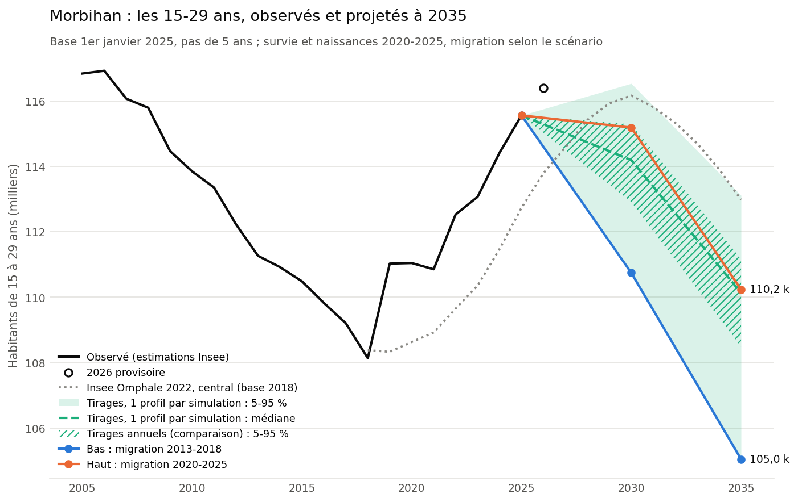
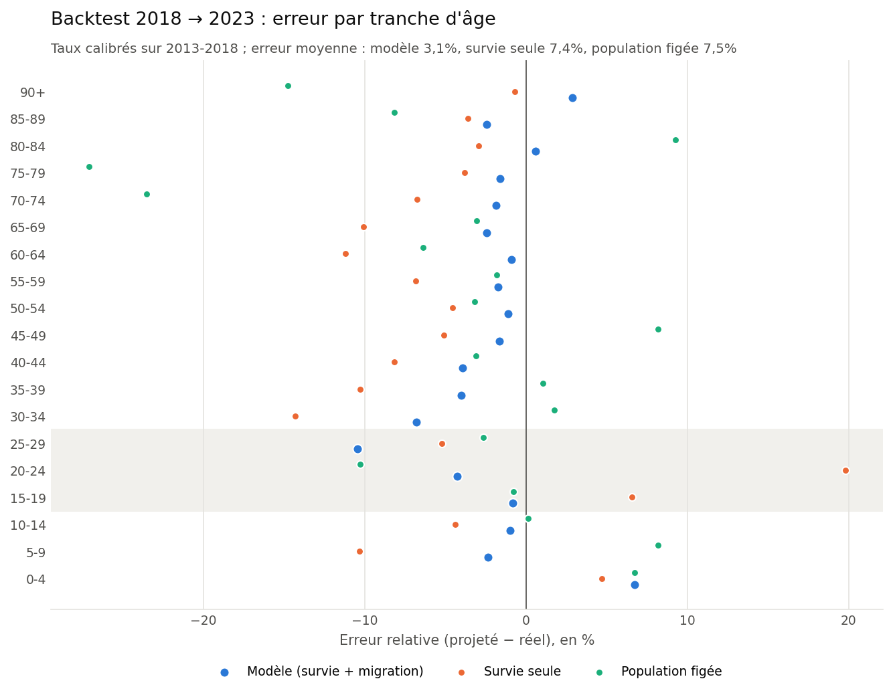
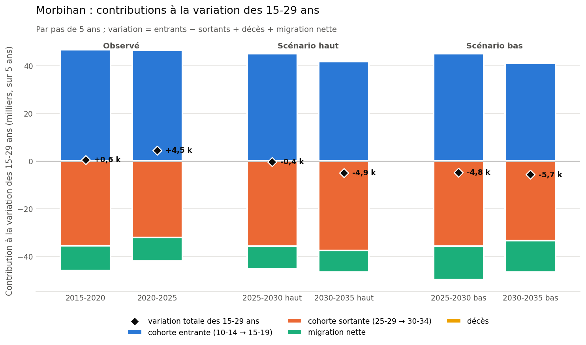

# Projection de la clientèle jeune : Morbihan (56)

Projection de la population des **15-29 ans** du Morbihan à 2030 et 2035 par la méthode des
composantes (survie, migration, naissances), avec backtest, scénarios et comparaison aux
projections officielles de l'INSEE (Omphale). La clientèle jeune s'en déduit par un taux de
pénétration par tranche (`src/projection.py::projeter_clients`).

Projet personnel réalisé par [SORO Doba issiaka], [2026].

## Résultats clés

- Les 15-29 ans du Morbihan passeraient de **115 555 (2025)** à **105 000-110 000 en 2035**
  selon la migration retenue (scénario bas : 105 049 ; scénario haut : 110 233).
- **Backtest 2018 → 2023 : 3,1 % d'erreur moyenne** par sexe et tranche d'âge, contre 7,4 % pour
  une projection sans migration et 7,5 % pour une population figée.
- **La migration est le principal facteur d'incertitude.** La baisse projetée vient surtout de
  cohortes d'entrée (10-14 ans) plus petites que les cohortes sortantes (25-29 ans).
- **Limite importante :** sur le seul total des 15-29 ans, le modèle ne fait pas mieux qu'une
  population figée (−4,8 % contre −4,4 % en 2023). Il sous-estime les 25-29 ans parce que la
  migration a changé de régime entre 2013-2018 et 2018-2023.



## Structure

```
projection-clientele-jeune/
├── README.md
├── requirements.txt
├── data/          # README des sources + script de téléchargement (pas les fichiers bruts)
├── notebooks/     # 01_donnees, 02_modele, 03_scenarios
├── src/           # chargement, qualite, taux, projection, graphiques
└── figures/       # graphiques générés
```

## Démarrage

Python 3.14 ; temps d'exécution : environ 5 minutes (la première lecture des fichiers Excel est
longue, voir `data/README.md`).

```bash
pip install -r requirements.txt
python data/telecharger_donnees.py   # décès par âge (Eurostat) et Omphale ; fichiers INSEE : voir data/README.md
```

Puis exécuter dans l'ordre :

1. `01_donnees.ipynb` : chargement (format long, Morbihan), **29 contrôles de qualité**, pyramide 2026
2. `02_modele.ipynb` : taux de survie et de migration nette 2020-2025, **backtest** 2018 → 2023
3. `03_scenarios.ipynb` : projections 2025 → 2030 → 2035, scénarios bas/haut, tirages aléatoires,
   comparaison avec Omphale

Les tirages aléatoires utilisent la graine `seed(42)` : les résultats sont reproductibles.

## Méthode

**Taux** (`src/taux.py`), sur une fenêtre de 5 ans :
- mortalité par sexe et tranche = décès / population moyenne, puis table de mortalité abrégée ;
- survie sur 5 ans S(a) = L(a+5) / L(a) ;
- migration nette **par différence** : population observée en fin de fenêtre − survivants attendus.

**Projection** (`src/projection.py`), un pas = 5 ans, par sexe :

- P(t+5, a+5) = S(a) · P(t, a) · (1 + m(a+5)), soit les survivants plus le solde migratoire ;
- P(t+5, 90+) = S(90+) · (P(t, 85-89) + P(t, 90+)) · (1 + m(90+)) ;
- P(t+5, 0-4) = naissances sur 5 ans · S(naissance) · (1 + m(0-4)).

Base : 1er janvier 2025 (fin de la fenêtre de taux), horizons 2030 et 2035. La population
provisoire 2026 sert uniquement de point de comparaison.

**Simplification : naissances constantes.** Les naissances futures sont fixées à leur niveau de
la fenêtre de calibrage. C'est sans effet sur la cible : les 15-29 ans de 2035 ont entre 5 et
19 ans aujourd'hui, ils sont déjà nés. Les naissances n'agissent que sur les 0-9 ans à l'horizon 2035.

### Backtest

Taux calibrés sur 2013-2018, projection 2018 → 2023, comparaison à la population estimée 2023,
par tranche d'âge. Références : survie seule, population figée, et « migration connue » (migration
réelle de 2018-2023 donnée à l'avance).

| Erreur sur 2023 | Modèle | Migration connue | Survie seule | Population figée |
|---|---|---|---|---|
| moyenne par sexe et tranche | 3,1 % | 0,9 % | 7,4 % | 7,5 % |
| 15-29 ans | −4,8 % | −0,03 % | +7,2 % | −4,4 % |



Avec la migration connue à l'avance, l'erreur sur les 15-29 ans disparaît : **la migration est le
facteur dominant**, d'où des scénarios qui ne font varier qu'elle. Ce résultat est presque vrai
par construction, car la migration 2018-2023 est calculée sur les mêmes données que celles
auxquelles on compare. Il montre l'importance de la migration, pas la qualité prédictive du modèle.

### Scénarios

Survie et naissances 2020-2025 dans tous les cas, seule la migration varie :
- **bas** : migration de la fenêtre 2013-2018 ;
- **haut** : migration de la fenêtre 2020-2025 ;
- **tirages aléatoires (retenu)** : un profil de migration par simulation, tiré parmi les
  8 fenêtres glissantes 2013-2018 … 2020-2025 et appliqué à tout l'horizon, parce que les régimes
  de migration durent (2013-2018 puis 2018-2023 : deux niveaux distincts) ;
- **tirages annuels (comparaison)** : un profil tiré chaque année. Sur 10 ans, les tirages se
  compensent, un régime durablement bas ou haut devient quasi impossible, et l'intervalle
  **sous-estime l'incertitude**.

| 15-29 ans en 2035 | 5 % | médiane | 95 % |
|---|---|---|---|
| 1 profil par simulation | 105 049 | 110 130 | 113 111 |
| tirage annuel | 108 487 | 109 931 | 111 168 |

### Décomposition

Sur un pas, variation des 15-29 ans = cohorte entrante (10-14 ans) − cohorte sortante (25-29 ans)
+ décès + migration nette. Après 2025, la migration des jeunes reste stable (≈ −9 500 à −14 000
par 5 ans selon le scénario). La baisse vient d'une cohorte entrante plus petite et d'une cohorte
sortante plus grosse (arrivées de jeunes adultes en 2018-2025).



### Comparaison externe : INSEE Omphale 2022

Base RP 2018 ; scénarios central, migrations basses et migrations hautes.
- La migration implicite des 15-29 ans dans Omphale (≈ −10 000 à −12 000 par 5 ans) tombe dans
  notre fourchette.
- Omphale reste stable à 2035 (+0,2 %) alors que nous baissons (−4,6 % à −9,1 %). L'écart semble
  venir de sa structure de départ : Omphale compte ≈ 30 500 personnes de 25-29 ans en 2025, contre
  ≈ 35 800 dans les estimations actuelles. [Vérifier que les deux sources utilisent la même définition de l'âge.]
- Omphale sous-estime lui aussi 2023 (−2,4 % sur les 15-29 ans, contre −4,8 % pour notre modèle).

### Passage à la clientèle (illustratif)

La population projetée est convertie en clientèle par un **taux de pénétration fictif** de
20 % des 15-29 ans (variantes 15 % et 25 %), constant dans le temps et identique pour toutes les
tranches. **Ce taux n'est pas issu de données bancaires** : il sert à illustrer le passage de la
population au portefeuille (`src/projection.py::projeter_clients`).

| Clients 15-29 ans | 2025 | 2030 haut | 2030 bas | 2035 haut | 2035 bas |
|---|---|---|---|---|---|
| 15 % | 17 333 | 17 277 | 16 611 | 16 535 | 15 757 |
| **20 %** | **23 111** | **23 036** | **22 149** | **22 047** | **21 010** |
| 25 % | 28 889 | 28 796 | 27 686 | 27 558 | 26 262 |

Résultat : à taux de pénétration constant, le portefeuille jeune suit la démographie et recule de
4,6 % (scénario haut) à 9,1 % (scénario bas) d'ici 2035, soit environ 1 100 à 2 100 clients en moins
pour un taux de 20 %. Pour garder le même nombre de clients en 2035, il faudrait porter le taux
de 20 % à environ 21 % (haut) ou 22 % (bas).

## Hypothèses

« Jeunes » = 15-29 ans (imposé par les tranches de 5 ans ; une clientèle bancaire jeune se définit
plutôt par 18-25 ou 18-30 ans) ; 51,2 % de garçons à la naissance ; tranches INSEE 90-94 et 95+
fusionnées en 90+ (comme Eurostat) ; populations 2024-2026 provisoires.

## Limites

- **Migration calculée par différence** : elle absorbe toutes les erreurs d'estimation (population
  provisoire, décès par âge issus d'une autre source).
- **Période 2020-2025 atypique** (Covid : surmortalité, mobilités), alors qu'elle sert de base au
  scénario haut.
- **Migration récente sous-estimée** : la population provisoire 2026 dépasse nos deux scénarios
  (−0,8 % à −1,6 % sur les 15-29 ans), comme dans le backtest et dans Omphale. Le scénario haut
  n'est pas un plafond. 2026 reste **provisoire**.
- **8 fenêtres qui se chevauchent** : la fourchette des tirages décrit les régimes observés depuis
  2013, pas une distribution de probabilité. Avec un profil par simulation, il n'y a que 8
  trajectoires possibles.
- **Naissances constantes** : sans effet sur les 15-29 ans d'ici 2035, elles ne biaisent que les 0-9 ans.
- **Départs des 15-19 ans** : le profil est compatible avec la mobilité pour études, mais les
  données ne donnent pas le motif.
- Décès par âge (Eurostat) disponibles jusqu'à 2024 seulement.
- **Hors périmètre** : pas de projection par commune, pas de comportements bancaires.

## Données

Sources, dates de téléchargement et conventions : voir [data/README.md](data/README.md).

